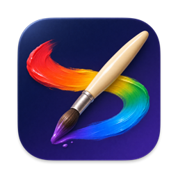
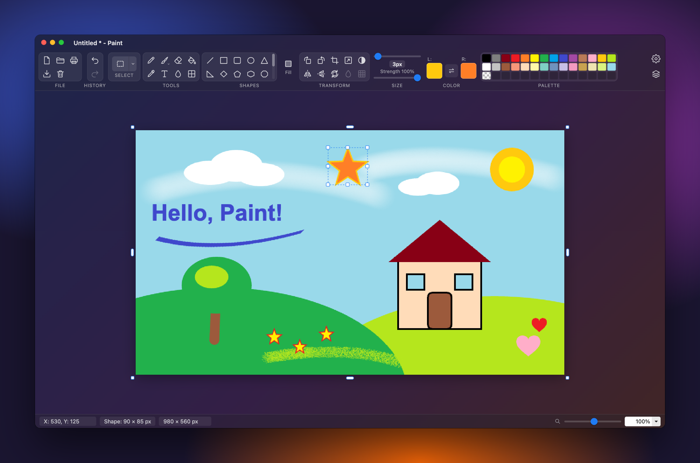
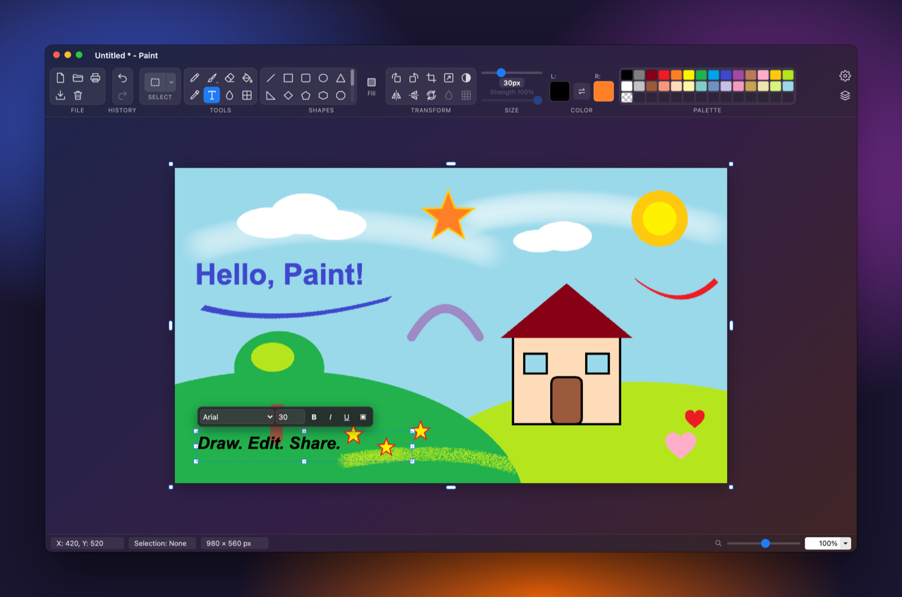
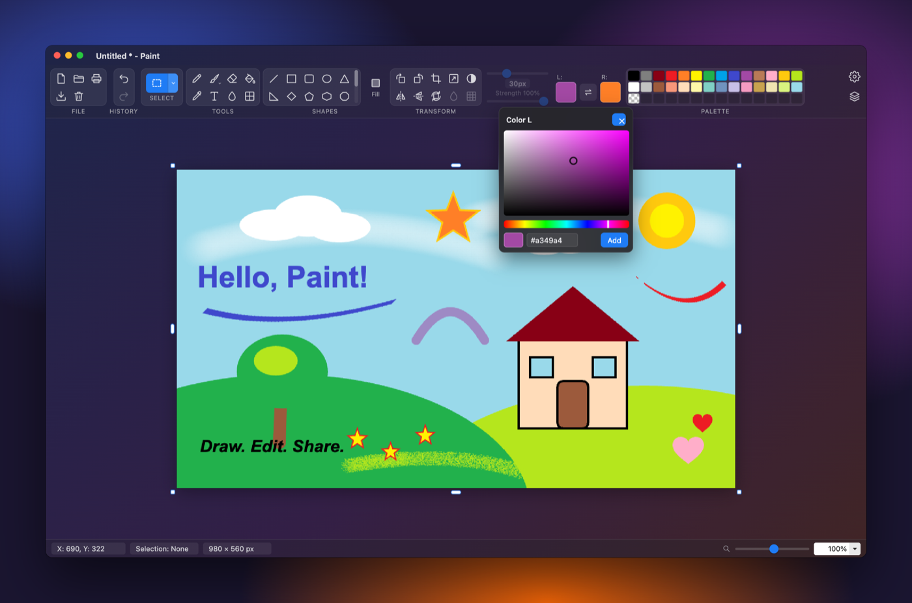
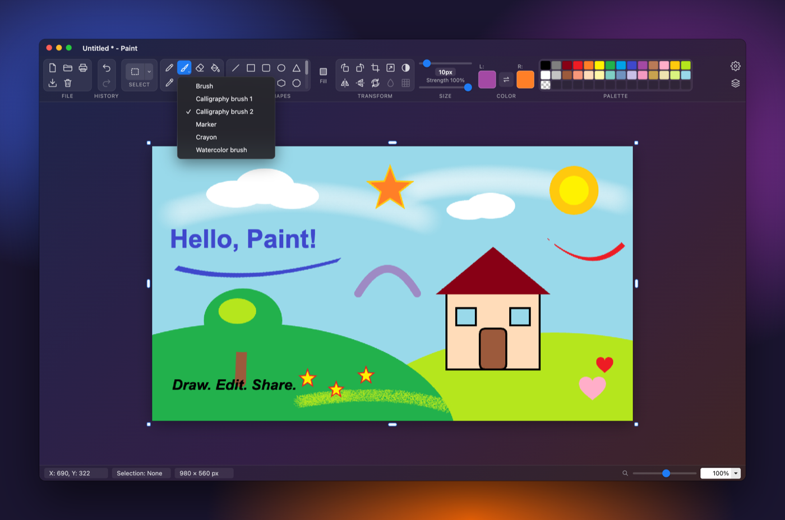
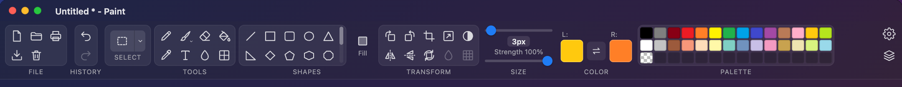

<div align="center">



# Paint

**The classic paint app, reimagined for macOS.**<br>
Simple, fast and fun to use: everything you loved about classic Paint, with a modern native Mac look.

[](https://github.com/PoPs9444/Paint/releases/latest)
[](https://github.com/PoPs9444/Paint/actions/workflows/build.yml)
[](#requirements)
[](native/main.swift)
[](LICENSE)
[](https://github.com/PoPs9444/Paint/releases)

[**Download**](https://github.com/PoPs9444/Paint/releases/latest) · [Features](#features) · [Screenshots](#screenshots) · [Shortcuts](#keyboard-shortcuts) · [Build from source](#build-from-source)

<br>



</div>

---

## Why Paint?

Most drawing apps on the Mac are either too basic or too complicated. **Paint** sits right in the middle. You can open it and start drawing straight away, and it still has the features you need for real work: shapes you can edit after drawing them, selections, layers and a full undo history.

- **Instant:** launches in a blink, a tiny download, no account, no subscription.
- **Familiar:** the ribbon layout, tools and gestures you already know from classic Paint.
- **Native:** translucent macOS window, Retina-sharp canvas, system clipboard, Finder "Open With", trackpad pinch-to-zoom.
- **Private:** works 100% offline. Your images never leave your Mac.

## Features

<table>
<tr>
<td width="50%" valign="top">

### 🎨 Drawing tools
- **Pencil:** pixel-perfect, aliased strokes
- **Brushes:** Brush, Calligraphy ×2, Marker, Crayon, Watercolor
- **Airbrush:** spray paint with adjustable density
- **Eraser:** paints with color R, or erases to transparency on layers
- **Fill bucket:** scanline flood fill with adjustable tolerance
- **Color picker:** samples the visible image
- **Text:** fonts, size, **bold**, *italic*, underline, opaque background

</td>
<td width="50%" valign="top">

### 🔷 Shapes
- **20 shapes:** line, rectangles, ellipse, triangles, diamond, pentagon, hexagon, octagon, four arrows, three stars, heart, lightning, callout
- **Stay editable** after drawing: move, resize, recolor, change their thickness
- **Outline only**, **fill only**, or **outline + fill**
- <kbd>Shift</kbd> keeps proportions, or snaps lines to 45°

</td>
</tr>
<tr>
<td valign="top">

### ✂️ Selection & editing
- Rectangular and **free-form** selection
- Move, resize, duplicate (<kbd>⌥</kbd>-drag), nudge with the arrow keys
- **Transparent selection** mode
- Cut / copy / paste with the **macOS clipboard** (paste screenshots straight in)
- Crop to selection, select all, delete

</td>
<td valign="top">

### 🔄 Image & document
- Rotate 90° / 180°, flip horizontally / vertically
- **Resize & skew** by percentage or pixels
- Invert colors, **blur** and **pixelate** a selection
- Resize the canvas by dragging its handles
- **Layers:** add, duplicate, reorder, merge, opacity, visibility
- Unlimited-feel **undo / redo**, zoom 10%–800%, gridlines

</td>
</tr>
</table>

**Colors:** left click paints with **color L** and right click with **color R**, just like classic Paint. You get a 28-color palette, a transparent swatch, an HSV color picker and 13 custom color slots that are remembered between launches.

**Files:** open PNG, JPEG, BMP, GIF, TIFF, HEIC and WebP. Save as PNG, JPEG, BMP, TIFF or GIF. You can also print, drag and drop images onto the window, and use *Open With → Paint* from Finder.

## Screenshots

<table>
<tr>
<td width="50%"><p align="center"><b>Layers</b>: stack, reorder and blend</p></td>
<td width="50%"><p align="center"><b>Text</b>: live editing with font controls</p></td>
</tr>
<tr>
<td width="50%"><p align="center"><b>Selection</b>: move, scale, crop, transform</p></td>
<td width="50%"><p align="center"><b>Colors</b>: HSV picker and custom palette</p></td>
</tr>
<tr>
<td width="50%"><p align="center"><b>Brushes</b>: six brush styles</p></td>
<td width="50%" valign="middle"><p align="center"><b>Ribbon</b>: every tool one click away</p></td>
</tr>
</table>

## Installation

### Download (recommended)

1. Download **`Paint-macOS.zip`** from the [latest release](https://github.com/PoPs9444/Paint/releases/latest).
2. Unzip it and drag **Paint.app** into your **Applications** folder.
3. The first time you open it, **right-click Paint.app → Open**, then confirm.
   The app is ad-hoc signed and not notarized by Apple, so macOS asks once.

> [!TIP]
> If macOS still refuses to open the app, run this command once:
> ```bash
> xattr -dr com.apple.quarantine /Applications/Paint.app
> ```

### Requirements

| | |
|---|---|
| **OS** | macOS 12 Monterey or later |
| **Chip** | Apple Silicon (release builds). Universal binaries are produced when the Intel toolchain is available |
| **Disk** | ~2 MB |

## Build from source

You need Xcode or just the **Command Line Tools** (`xcode-select --install`).

```bash
git clone https://github.com/PoPs9444/Paint.git
cd Paint
./build.sh          # builds Paint.app
./build.sh --zip      # also packages Paint-macOS.zip
./build.sh --install  # also installs into /Applications (Spotlight & Launchpad)
open Paint.app
```

The UI is plain HTML/CSS/JS, so you can also work on it in any browser without compiling anything. In the browser, saving falls back to downloads and opening uses a file picker.

```bash
python3 -m http.server 8000 -d web   # then open http://localhost:8000
```

## Keyboard shortcuts

| Action | Shortcut | | Tool | Key |
|---|---|---|---|---|
| New | <kbd>⌘</kbd> <kbd>N</kbd> | | Select | <kbd>S</kbd> |
| Open | <kbd>⌘</kbd> <kbd>O</kbd> | | Pencil | <kbd>P</kbd> |
| Save / Save As | <kbd>⌘</kbd> <kbd>S</kbd> / <kbd>⇧</kbd> <kbd>⌘</kbd> <kbd>S</kbd> | | Brush | <kbd>B</kbd> |
| Print | <kbd>⌘</kbd> <kbd>P</kbd> | | Eraser | <kbd>E</kbd> |
| Undo / Redo | <kbd>⌘</kbd> <kbd>Z</kbd> / <kbd>⇧</kbd> <kbd>⌘</kbd> <kbd>Z</kbd> | | Fill | <kbd>G</kbd> |
| Cut / Copy / Paste | <kbd>⌘</kbd> <kbd>X</kbd> / <kbd>C</kbd> / <kbd>V</kbd> | | Color picker | <kbd>I</kbd> |
| Select all | <kbd>⌘</kbd> <kbd>A</kbd> | | Text | <kbd>T</kbd> |
| Crop to selection | <kbd>⇧</kbd> <kbd>⌘</kbd> <kbd>X</kbd> | | Airbrush | <kbd>A</kbd> |
| Resize & skew | <kbd>⌘</kbd> <kbd>E</kbd> | | Line / Rect / Ellipse | <kbd>L</kbd> / <kbd>R</kbd> / <kbd>O</kbd> |
| Invert colors | <kbd>⇧</kbd> <kbd>⌘</kbd> <kbd>I</kbd> | | Swap colors L ⇄ R | <kbd>X</kbd> |
| Zoom in / out / 100% | <kbd>⌘</kbd> <kbd>+</kbd> / <kbd>−</kbd> / <kbd>0</kbd> | | Brush size | <kbd>[</kbd> <kbd>]</kbd> |
| Fit to window | <kbd>⌘</kbd> <kbd>9</kbd> | | Delete selection | <kbd>⌫</kbd> |
| Gridlines / Layers | <kbd>⌘</kbd> <kbd>G</kbd> / <kbd>⌘</kbd> <kbd>L</kbd> | | Commit / deselect | <kbd>Esc</kbd> |

**Mouse:** right click (or <kbd>⌃</kbd>-click) uses color R · <kbd>Shift</kbd> constrains shapes · <kbd>⌥</kbd>-drag duplicates a selection · pinch or <kbd>⌘</kbd>-scroll zooms.

## Architecture

Paint is a small native Cocoa shell around a fast canvas engine. There are no dependencies, frameworks or build systems beyond `swiftc`.

```
Paint/
├── native/
│   ├── main.swift        # NSWindow + vibrancy, WKWebView host, menus,
│   │                     # open/save panels, clipboard, printing, file encoding
│   ├── Info.plist        # bundle metadata & image document types
│   └── AppIcon.png       # 1024×1024 master icon (converted to .icns at build time)
├── web/
│   ├── index.html        # ribbon, workspace, panels
│   ├── style.css         # macOS-style dark glass UI
│   └── app.js            # the paint engine (tools, history, layers, selection…)
├── docs/images/          # README assets
└── build.sh              # one-command build → Paint.app
```

- **Engine:** each layer is an HTML canvas. Strokes and shapes render into a scratch buffer and are composited onto a snapshot of the layer. That gives correct opacity, live editable shapes and erase-to-transparency, and only the changed region is redrawn.
- **History:** snapshot-based undo/redo, capped by memory, so big images stay responsive.
- **Bridge:** the web layer talks to Swift through `WKScriptMessageHandler`. Swift handles everything the browser can't do natively: save panels with format selection, JPEG/BMP flattening, `NSPasteboard` images, `NSPrintOperation` and Finder document opening.

## Roadmap

- [ ] Magic-wand selection
- [ ] Color replacer (right-drag eraser, like classic Paint)
- [ ] Rulers and a status-bar pixel color readout
- [ ] Notarized, universal release builds
- [ ] Localizations (French, Spanish, German…)

Have an idea? [Open a feature request](https://github.com/PoPs9444/Paint/issues/new?template=feature_request.md).

## Contributing

Contributions are welcome! Please read [CONTRIBUTING.md](CONTRIBUTING.md) first. In short: fork, create a branch, keep pull requests focused, and describe how you tested your change.

## License

Released under the [MIT License](LICENSE). © 2026 PoPs9444.

<sub>Paint is an independent project inspired by the simplicity of classic paint programs. It is not affiliated with, endorsed by, or connected to Microsoft or Apple.</sub>
